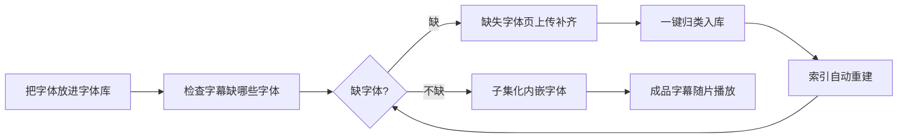

# 字体分类管家（Zitifenlei）使用手册

> 字体归档整理与 ASS 字幕字体检查插件：整理字体文件、检查字幕缺不缺字体，并把字幕用到的字体**子集化内嵌**进字幕，让任何播放器都能正确显示。

---

## 目录

1. [它能做什么](#1-它能做什么)
2. [安装与启用](#2-安装与启用)
3. [界面导航](#3-界面导航)
4. [快速上手](#4-快速上手)
5. [功能详解](#5-功能详解)
   - 5.1 仪表盘
   - 5.2 字体库（归档整理）
   - 5.3 检查（字幕缺字体检查）
   - 5.4 子集化
   - 5.5 缺失字体
   - 5.6 种子字体收集
   - 5.7 设置项逐项说明
6. [自动化与联动](#6-自动化与联动)
7. [常见问题](#7-常见问题)

---

## 1. 它能做什么

- **整理字体**：把散落的字体文件（`.ttf/.otf/.ttc/.woff/.woff2`）扫描/上传进统一的字体库，按「厂商 → 格式 → 字体名」归档，自动识别常见厂商（思源/Google、森泽 MO、华文 ST、方正等）。
- **检查字幕**：解析 ASS 字幕实际用到的字体清单，对照字体库告诉你哪些字体缺失、哪些字幕已内嵌字体。
- **子集化**：用内置 HarfBuzz（uharfbuzz）把字幕用到的字体「精简 + 内嵌」进字幕文件，成品字幕脱离字体库也能显示（播放手机、电视、NAS 播放器都不乱码）。
- **种子字体收集**：只读下载器，按设定间隔轮询已完成的种子，从种子文件清单里截取字体与字体包（zip/7z/rar）自动入库。
- **全自动**：目录监控 + MoviePilot 入库联动，放进去就处理，处理完发通知。

---

## 2. 安装与启用

1. **安装**：MoviePilot → 插件市场 → 添加本仓库 `/LXT-A-X/MoviePilot-Plugins` → 搜索「字体分类管家」安装。
2. **依赖**：安装时自动按 `requirements.txt` 安装（`fontTools`、`uharfbuzz`、`watchdog`）；子集化内核为 Python 依赖，无需额外部署二进制。
3. **启用**：设置页 → 插件总开关 → 打开，保存配置生效。关闭后所有功能不可用、后台任务停止。

> 依赖状态在「仪表盘」顶部可查看；子集化功能需要「字体索引」构建成功后使用（详见 5.4）。

---

## 3. 界面导航

| 页面 | 作用 |
| --- | --- |
| **仪表盘** | 总体状态：字体总数/待整理/最近子集化/缺失字体统计、厂商分布、目录健康度、最近操作日志 |
| **字体库** | 左侧目录树（厂商/格式/字体）+ 右侧字体列表，上传、归档、全量检查、收藏、预览 |
| **检查** | ASS 字幕缺字体检查列表与详情，可上传字幕检查、全量检查字幕目录 |
| **子集化** | HarfBuzz 引擎状态与字体索引、全量子集化、待处理队列、处理结果（筛选/搜索/全部下载/重试失败） |
| **缺失字体** | 统一收集「检查缺失」与「子集化缺失」的字体，上传、归类入库、清除 |
| **设置** | 插件总开关、目录配置、种子字体收集、扫描/归档模式、自动化、子集化、HDR 亮度 |

---

## 4. 快速上手

**第一次使用建议：**
1. **设置页**配置目录：`字体监控目录`（放待整理字体或字体压缩包）、`字体库目录`（归档目标，必填）、`ASS字幕目录监控`（要检查的字幕）、`ASS目录监控子集`（放进即子集化的字幕）；`子集化输出目录` 可选（成品同步位置）。**填了哪个目录就监控哪个、全空则不监控**，不再有总开关。保存。
2. **字体库页**点「全量检查」：把字体监控目录里的字体归档进字体库（自动识别厂商/格式归类）；以后把字体或字体压缩包丢进监控目录会自动处理。
3. **子集化页**点「全部重建」：清空索引后让 fontTools 逐文件重新解析字体库（检查/子集化都依赖它；日常入库自动增量，不需要点）。
4. **子集化页**上传要处理的字幕，点「全量子集化」，成功后右侧结果区下载成品 `.ziti.ass`。
5. 「是否自动执行监控结果」决定监控到文件后直接处理还是先进待定；需要 MP 入库联动再设置「MP 入库时」的处理方式。

---

## 5. 功能详解

### 5.1 仪表盘

- **状态条**：插件启用状态、数据库状态、运行依赖（fontTools 等）检测，可点击查看明细。
- **统计卡**：字体文件数（下方附带索引的 face 数，TTC/OTC 一个文件含多个 face，两个数天然不等）/ 待整理（监控目录里还没归档的字体数）/ 最近子集化数量 / 缺失字体。
- **厂商分布**：字体库按厂商的占比条（上下滚动列表）。
- **目录健康度**：4 个配置目录是否存在，一眼看出路径配错。
- **最近操作日志**：插件内部处理记录（含错误原因），排查问题先看这里。

### 5.2 字体库（归档整理）

- **左侧目录树**：按「厂商 → 格式(ttf/otf/ttc…) → 字体文件」展示字体库结构。
- **上传字体**：上传后进「待确认」，点「确认」或「一键整理」归档入库。
- **全量检查**：递归扫描字体监控目录，把里面的字体归档进字体库（归档成功自动重建字体索引）。
- **待确认区**：监控（自动执行关闭时）或上传产生的新字体先停在这里，确认后入库。
- **归档规则**：按「字体库/厂商/格式/基础名.后缀」存放（如 `字体库/思源黑体/otf/SourceHanSansCN-Bold.otf`），同名同格式自动跳过不覆盖；不同格式（`.ttf`/`.otf`）可共存。
- **厂商识别**：优先读字体内部制造商名；文件名 `MO+字母` 前缀识别为森泽；`ST`=华文；思源/Source Han=Adobe；Noto/Google=Google；其余归「未知厂商」。
- **「利用字体内部名称命名」开关**：开=用字体内部 PostScript 名归档（如 `SourceHanSansCN-Bold`）；关=保持原文件名。
- 字体条目可**收藏**（星标）、**预览**（TTC 等格式也能正常预览）、**删除**。

### 5.3 检查（字幕缺字体检查）

- 上传 ASS 字幕或点「全量检查」扫描 ASS 字幕目录后，逐条解析字幕用到的字体并对照字体库。
- 状态：**字体齐全 / 已子集化（自带内嵌字体）/ 缺字体**（列出缺失的字体名）。
- 顶部显示「**匹配基准**」：`字体索引（fontTools）` 或 `字体库记录（索引未构建）`——提示当前检查是哪套口径。若显示后者，去「子集化」页点「全部重建」。
- 检查出的缺失字体自动进「缺失字体」页，可跳转补齐。
- **记录分组**：左栏按「压缩包 / 本次上传批次 / 字幕所在目录」分组，组默认收起；组头显示条数与「完整 / 缺字体 / 待检查」计数，可「全部检查」本组，或 ✕ 二次确认后删除整组。
- **筛选与搜索**：记录卡片标题行可切换状态（全部 / 待检查 / 缺字体 / 完整）并按文件名搜索；右侧「全部清空」二次确认后清空全部记录。
- **检查不会删除任何字幕文件**：只解析与比对；「清空全部」会删除记录和上传到插件的临时副本，监控目录/媒体库里的原字幕始终保留。

### 5.4 子集化

- **状态条**：`字体库索引：N 个 face（构建时间）` + 「全部重建」按钮。索引是检查与子集化的公共口径：**新字体入库/删除会自动增量增/减**；「全部重建」= 清空索引后逐文件重新解析（只在索引异常/修复时用）。HarfBuzz 引擎状态见「仪表盘 → 依赖」，未就绪时本页顶部会红字提示。
- **待处理队列（左栏）**：上传的字幕（手动）、「入库后自动子集化」或「ASS 自动子集化目录」收集的字幕（显示来源与时间，可移除）。
- **全量子集化**：处理左栏全部待处理字幕。运行中按钮转圈防连点，与入库子集化互斥。
- **结果区（右栏）**：成功/缺字体/可重试/失败/跳过状态，成功带输出文件路径、可下载；顶部状态下拉 + 字幕名搜索可筛选；「全部下载」按当前筛选一次性串行下载全部成功成品（未筛选=全部）；「全部清空」清空全部记录，并删除监控/上传来历的成品（MP 入库只删记录，不动媒体库原字幕）。
- **通知**：手动上传后点「全量子集化」或「重试失败」不发系统通知（结果看页面提示与记录列表）；目录监控与 MP 入库自动处理完成才推送通知。
  - 缺字体 → 点状态标签跳「缺失字体」页补字体，补齐后状态变「可重试」，点顶部「**重试失败**」重新子集化。
- **成品命名**：MP 入库由「MP 入库替换原字幕」控制——开=直接替换媒体库原字幕（文件名不变）；关=保留原字幕，生成 `xx.ziti.ass`。监控目录由「监控目录输出方式」控制——复制=源字幕保留，移动=输出成功后删除源字幕。手动上传永不覆盖源字幕，统一生成 `xx.ziti.ass`。
- **字体内嵌**：所有成品都会把用到的字体子集化后内嵌进 `[Fonts]`，不再产生 `*_subsetted` 字体备份夹（旧版本遗留的备份夹会在源字幕删除时自动清理）。

### 5.5 缺失字体

- 左栏「**检查缺失**」+ 右栏「**子集化缺失**」自动聚合，最多显示 5 种，其余可「展开全部」。
- **把字体文件拖进对应栏**（或缺字体失败后跳转本页上传）→ 点「**归类**」：归档入库 → 自动重建索引 → 通知 → 回子集化页重试。
- 「清除全部」清空已上传临时字体；单条可删除。

### 5.6 种子字体收集

只读下载器：不改下载任务、不删种子、不扫下载目录，从「种子已完成」的状态出发，按种子文件清单把字体从下载保存路径复制出来归档。

- **触发方式：只轮询下载器**。插件按「兜底扫描间隔」定时扫描各下载器已完成的种子（上一轮没跑完自动跳过），也可在设置页点「立即检查下载器」手动扫一次。**不接 MP 整理事件**：移动模式下 MP 整理完就把下载目录清空了，整理后再去取文件只会取到空。
- **挑文件的规则**：
  - 裸字体文件（`.ttf/.otf/.ttc/.otc/.woff/.woff2`）按后缀直接收，不看名字；
  - 压缩包（`zip/7z/rar`）必须命中「关键词」才收（默认 `font,fonts,字体`，逗号分隔）；
  - 只收下载进度 100% 的文件；超过「单文件上限」或「单种子最多文件」的部分跳过。
- **解压能力**：zip 内置；7z/rar 需容器内有 7z/7zz/unar/unrar/bsdtar 之一（多个工具会按顺序逐个尝试，某个不支持自动换下一个）。未安装时可在「仪表盘 → 依赖 → 解压工具」或设置页点「安装解压工具」，插件会在容器内用 apt/apk 自动安装 unar（需要容器 root 与联网；容器重建/更新镜像后需重装）。设置页状态行会显示当前能力，未装时这类压缩包记成跳过并在提示里写明原因。
- **收集去向**：「收集后进待整理」关＝直接归档进字体库（走哈希去重与厂商归档，索引自动重建）；开＝先进「待整理」等确认。
- **基线**：开启后自动记录基线时间，只处理基线之后完成的种子，历史种子不回溯；「重置基线为现在」后只收更新的种子。
- **路径前提**：下载器返回的保存路径必须在插件侧可读（跨容器需要 MP 的路径映射），否则记录里会显示「下载路径在插件侧不可访问」。
- **状态与记录**：设置页底部显示下载器、解压能力、基线时间与正在收集数量；「最近收集记录」按 完成 / 无字体 / 失败 展示，可一键清空（只删记录，不动字体库与下载目录）。

### 5.7 设置项逐项说明

| 区块 | 设置项 | 说明 |
| --- | --- | --- |
| 总开关 | 启用字体分类管家 | 关闭=所有功能不可用、后台任务停止；**后台有任务运行时无法关闭**（弹提示等任务完成再关，避免数据半截） |
| 目录 | 字体监控目录 | 放字体文件或字体压缩包（.zip/.7z/.rar，自动安全解压后逐个归档/进待确认；处理过的包按「路径+大小+mtime」指纹去重，不会重复解压） |
| 目录 | 字体库目录 | 归档目标，按厂商/格式/名称整理（必填，检查/子集化的字体唯一来源） |
| 目录 | ASS 字幕检查目录 | 放入字幕自动检查缺字体 |
| 目录 | ASS 自动子集化目录 | 放入的字幕直接进入子集化流程，成品把字体子集化后内嵌 |
| 目录 | 子集化输出目录 | 子集化成品的同步位置（可选） |
| 目录 | 解压整理后自动清理压缩包 | 默认关。开=压缩包在「字体监控目录」内解压并整理成功后清理：按「清理方式」移到 `<字体监控目录>/已处理压缩包/` 或直接删除。**只有「自动执行开 + 无失败 + 有归档/去重结果」才执行**；进待确认、有失败、放错目录一律保留并提醒 |
| 目录 | 压缩包清理方式 | `移到 已处理压缩包/`（默认，可找回）或 `直接删除`（不可恢复） |
| 归档模式 | 复制保留原文件/移动原文件 | 归档时复制还是移动源字体 |
| 归档 | 利用字体内部名称命名 | 开=用字体 PostScript 名归档；关=保原文件名 |
| 种子收集 | 启用种子字体收集 | 只读下载器：按设定间隔轮询已完成种子，从文件清单截取字体与字体包；不删种子、不扫下载目录、不接 MP 整理事件 |
| 种子收集 | 兜底扫描间隔（分钟） | 默认 30，可填 1~1440。定时任务每分钟唤醒、到点才真正扫描；保存后即时生效，太小会增加下载器查询频率 |
| 种子收集 | 关键词（逗号分隔） | 只对压缩包生效（默认 `font,fonts,字体`）；裸字体文件按后缀直接收 |
| 种子收集 | 单文件上限（MB） / 单种子最多文件 | 默认 2048MB / 500 个，超出的部分跳过 |
| 种子收集 | 收集后进「待整理」 | 开=先等待确认；关=直接归档进字体库（默认） |
| 自动化 | 是否自动执行监控结果 | 开=监控到直接执行（字体归档 / 字幕检查 / 子集化；压缩包解压出的字体直接归档）；关=待定（字体与压缩包解出的字体进待确认、检查进待检查、子集化进待处理） |
| 高级/维护 | 启动轻检 | 启动时按大小/修改时间校验索引：失效记录撤销、变更文件只重解析该文件、磁盘有而索引没有的新字体一并补索引；索引为空则自动从磁盘重建字体库 |
| 高级/维护 | 每周差异核对 | 默认开启。每周日凌晨 4:30 与磁盘指纹比对索引，只处理差异文件，另对「未变」文件抽检 50 个重算哈希（发现同大小同时间戳的内容替换）（保存后需重载插件生效） |
| 自动化 | MP 入库时 | 三选一：不处理 / 自动检查字幕 / 自动子集化（原两个互斥开关合并为一项，避免误配） |
| 自动化 | 发送通知 | 归档/检查/子集化结果通过系统通知发送（字体、字幕、压缩包分类消息） |
| 子集化 | MP 入库替换原字幕 | 开=入库成品直接替换媒体库原字幕（原名不变、只保留一份）；关=保留原字幕另生成 `xx.ziti.ass`；只作用于 MP 入库 |
| 子集化 | 监控目录输出方式 | 只作用于目录监控。配了输出目录：复制=成品进输出目录、源字幕保留（默认）；移动=成品进输出目录、成功后删除源字幕。未配输出目录：复制=另生成 `xx.ziti.ass` 并保留源；移动=成品就地替换源字幕。监控来源成品按「输出目录/剧名/」分类输出 |
| 高级/维护 | 字体文件大小上限 | 默认 128MB。超过该值的字体不做哈希/解析、不接受上传；超大 TTC 调大后需「全部重建」索引才会纳入 |
| 子集化 | HDR 字幕亮度 | 下拉选择：关闭 / 100% / 85% / 80%（推荐）/ 75% / 70% / 63% / 50%；成品字幕按档位压暗主色/描边/阴影，避免 HDR 下纯白字幕刺眼 |

---

## 6. 自动化与联动

**① 目录监控三条链路**（不再有总开关：**填了哪个目录就监控哪个，全空则不启动监控**）：

| 目录 | 自动执行开 | 自动执行关 |
| --- | --- | --- |
| 字体监控目录 | 字体直接归档入库；字体压缩包自动解压后逐个归档 | 字体与压缩包解出的字体都进「待确认」等待一键整理（压缩包保留） |
| ASS 字幕检查目录 | 新字幕直接检查字体并发通知 | 登记等待检查 |
| ASS 自动子集化目录 | 新字幕直接子集化，成品按剧名分类同步输出目录 | 进「子集化-待处理」等待手动处理 |

> **压缩包处理规则**：字体监控目录里的 `.zip/.7z/.rar` 会安全解压并逐个处理，处理结果单独发「压缩包处理」通知（含解出数量、归档/待确认/失败、压缩包去向）。开启了「解压整理后自动清理压缩包」且满足条件时，按清理方式移到 `已处理压缩包/` 或删除；**放错目录、进待确认、有失败时一律保留并提醒**。
>
> **目录类型严格**：监控事件按「文件所在目录」决定处理类型——字体监控目录只收字体/字体压缩包，ASS 字幕检查目录与自动子集化目录只收 `.ass`，字体库目录只做增量索引。**放错目录的字体/字幕会被跳过并写入「最近操作日志」；放错目录的压缩包还会发通知提醒，并且绝不删除/移动**。

**② MoviePilot 入库联动**（`SubtitleTransferComplete` 事件）：
- 开启「入库自动检查字幕」→ 剧集入库 30 秒聚合后自动检查该剧字幕，汇总通知（缺哪些字体一目了然）。
- 开启「入库后自动子集化」→ 入库字幕自动内嵌字体，成品留在媒体库原位置，播放即走。
- 两者互斥，一次只能开一个；与目录监控/全量子集化互斥执行，不并发打架。

**③ 种子字体收集（只轮询下载器）**：
- 按「兜底扫描间隔」扫描各下载器已完成种子 → 从保存路径复制字体/字体包 → 解压 → 归档入库 → 索引自动重建。
- 与 MP 整理完全独立：不监听 `TransferComplete` 与字幕入库事件，MP 整不整理、怎么整理都不影响收集。
- 已收集过（记录为 完成 / 无字体）的种子不会重复收集；失败的会在下一轮扫描重试。
- 注意：移动模式下 MP 整理会清空下载目录，扫描间隔要短于「下载完成 → 整理」的窗口（建议 2~5 分钟），或把整理方式改成硬链接/复制。

**④ 索引自动重建闭环**：
- 字体归档 / 一键整理 / 缺失字体归类 → 自动更新字体索引（5 秒聚合去重）→ 检查与子集化立即用新索引，无需手动「全部重建」。

**⑤ 缺失字体闭环**：
- 检查缺字体 → 缺失字体页上传 → 严格校验（同一 face 名称命中 + 真实覆盖缺失字符）→ 归类入库 → 索引自动重建 → 子集化缺失实时消失 → 对应记录变「可重试」→ 重试失败一键重新子集化。
- 上传的字体若未通过严格校验：直接丢弃临时文件，不会污染字体库。

**⑥ 安全性**：
- 全量检查/扫描/子集化运行中使用互斥锁，页面重复点击不会并发执行；数据库恢复/清库/删除字体/全部重建之间互斥（维护期间监控事件排队，结束后补处理）。
- **删除检查记录只清理插件临时目录内的字幕副本**：监控目录/媒体库里的原始字幕只删记录、绝不删文件。
- **全量重建有完整性门槛**：出现权限/IO/解析异常等「结果不确定」的文件时不提交暂存索引（保留旧索引可用），需先排除问题再重建。
- **关闭插件**时会等待后台任务把当前条目完整处理完再停（60 秒兜底），不留「文件已入库但记录缺失」的半截状态；总开关在任务运行中直接拦截弹提示。
- 归档写库失败自动回滚已拷贝/移动的文件。
- 监控事件处理失败会清除 60 秒去重标记并自动重试（最多 3 次），复制半截的大字体不会因为首个事件失败而永久漏处理。
- 配置保存若宿主持久化失败会明确报错（提示「仅当前会话生效」），不会假装保存成功。
- 「完整」只在完成逐字符（cmap 单 face）验证后显示；索引不可用/无有效用字/解析失败时显示「未验证字形（仅名称匹配）」，不把名称存在当字形完整。

**⑦ 通知（可选）**：
- 字体归档 / 字幕检查 / 子集化成功 · 缺字体 · 失败分别归类聚合通知，6 秒窗口合并，批量放入不刷屏。
- **压缩包处理单独一条通知**（与普通目录字体通知分开）：每个包一行「解出 N 个 → 归档 A / 待确认 P / 失败 F；已删除 / 已移到 已处理压缩包 / 保留（原因）」；放错目录的压缩包会单独提醒且不删除。

---

## 7. 常见问题

**Q：字体放进监控目录没反应？**
先确认「字体监控目录」确实填了且「仪表盘-目录健康度」显示目录可达（现在**填了目录就自动监控，没有总开关**）；再看「是否自动执行监控结果」；最后看「最近操作日志」。

**Q：种子字体收集一直没动静？**
按顺序排查：① 设置页「启用种子字体收集」是否打开、距上次扫描是否已到「兜底扫描间隔」（可点「立即检查下载器」手动触发）；② 状态行里下载器是否显示「不可用」（客户端登录失败）；③ 压缩包是否命中关键词（裸字体不看关键词）；④ 记录里若显示「下载路径在插件侧不可访问」，检查 MP 下载器的路径映射；⑤ 移动模式下 MP 整理会清空下载目录，把间隔调小或改用硬链接/复制整理。

**Q：字幕检查一直说缺字体，但字体明明在库里？**
检查「匹配基准」是否显示「字体库记录（索引未构建）」——去「子集化」页点「全部重建」，让检查与子集化用同一套索引口径。

**Q：新归档的字体子集化用不上？**
索引随归档自动增量更新；若个别情况没生效，去「子集化」页点「全部重建」（清空索引逐文件重解析）刷新。

**Q：上传 .rar/.7z 失败，提示「未检测到解压工具」或「没有可上传的文件」？**
按顺序排查：① 打开「仪表盘 → 依赖 → 解压工具」看 rar/7z 是否显示可用；② 不可用就点「安装解压工具」，等容器内 apt/apk 装完 unar（需要 root 与联网，容器重建/更新镜像后要重装）；③ 装好后重新上传即可。插件会依次尝试 7z/7zz/unar/unrar/bsdtar，某个工具不支持会自动换下一个，不会再因为「只装了 7za 但 7za 解不了 rar」直接判失败。上传失败的跳过原因现在会写进「最近操作日志」，不再只有一句笼统提示。

**Q：手机上传压缩包时文件是灰色/选不到？**
插件上传框已同时声明扩展名和常见 MIME（application/x-rar-compressed、application/vnd.rar、application/octet-stream 等），安卓/苹果的文件选择器都能把 .zip/.7z/.rar 显示出来。如果仍然选不到：① 确认文件确实在本机「下载/文档」目录，而不是微信/QQ 的私有目录（安卓 11+ 系统选择器进不去这些目录，先「另存为/导出」到下载目录）；② 微信内置浏览器对文件选择支持较差，换系统浏览器（Chrome/Safari）打开 MoviePilot 再传。

**Q：缺失字体上传后为什么还要「映射」？需要手动指定目标吗？**
不需要。上传校验会**自动**用字体内部名称/别名（中文名、英文名、全名、PostScript 名、家族名）以及**上传文件名（去后缀）**去匹配当前缺失目标：命中且同一个 face 真实覆盖缺失字符就直接进「已上传待归类」，日志里会显示「自动匹配: 字体 → 缺失字体」。只有自动匹配失败（提示「与当前缺失字体不匹配」或「名称匹配但未覆盖任何缺失字符」）时，才需要在「目标缺失字体」下拉里手动指定；**留空就是自动匹配**。已上传字体上的「改派」是可选操作，用于改到其它缺失目标或在多个相似字体里指定。

**Q：上传大字体包报 413 Request Entity Too Large / 上传不了？**
413 是 MoviePilot **自带 nginx** 的请求体限制（默认 `NGINX_CLIENT_MAX_BODY_SIZE=50m`），不是插件的字体大小上限。两条路：① 把字体压缩包直接放进「字体监控目录」，插件会自动解压并逐个归档（本版起支持，处理过的包不会重复解压）；② 在 MP 的 compose/app.env 里把 `NGINX_CLIENT_MAX_BODY_SIZE` 调大（如 `512m`）后重启容器。

**Q：文件放错监控目录了会怎样？**
按目录类型严格处理：字体目录只收字体/字体压缩包、字幕目录只收 `.ass`、字体库目录只做索引；类型不匹配的文件会被**跳过**并写入「最近操作日志」，不会被错误归档或错误检查，也不会反复重试刷日志。**压缩包放错目录时只会提醒、不会删除/移动**（系统通知 + 日志），并提示字体包应放字体监控目录、字幕包应到「检查 / 子集化」页上传。

**Q：字幕压缩包能用吗？有哪些限制？**
字幕压缩包走**上传通道**（「检查」页 / 「子集化」页上传字幕时）：支持 `.zip/.7z/.rar`，只解一层、只取 `.ass`。限制：单次最多 50 个文件、压缩包成员最多 500、上传/解压总量 512MB、单个 `.ass` 16MB；`.zip` 内置，`.7z/.rar` 需先装解压工具；MP 自带 nginx 还有默认 50MB 请求体限制（超过会 413，需调大 `NGINX_CLIENT_MAX_BODY_SIZE`）。**目录监控目前只有「字体监控目录」收压缩包，且只解字体**；字幕目录不收压缩包。
- 如果误把字幕压缩包放进字体监控目录：会按字体包解压，解出 0 个字体并**保留原包**，日志/通知会提示「包内是字幕（.ass），不是字体；字幕压缩包请到「检查 / 子集化」页上传」。

**Q：压缩包解压后文件在哪？会自动删除吗？**
解压中间文件放在插件数据目录 `tmp/watch_archive_*/`（处理完自动清理）；字体最终按「厂商/格式/名称」进「字体库目录」；压缩包本身默认留在「字体监控目录」不动。开启「解压整理后自动清理压缩包」后，满足条件的包会按「清理方式」移到 `已处理压缩包/` 或直接删除；进待确认/有失败/放错目录则保留。

**Q：子集化页提示 HarfBuzz 未就绪？**
到「仪表盘 → 依赖」中点 uharfbuzz（子集化引擎）的「重新安装」，装好后刷新页面；该状态不再放在设置页。

**Q：TTC 字体预览失败/无法解析？**
插件会对 TTC 自动拆 face 重存并修复结构损坏的 cmap，正常字体零影响；仍失败请确认文件未损坏。

**Q：子集化成品的文件名怎么带「原字幕.ziti.ass」？**
配了子集化输出目录时，成品一律以 `xx.ziti.ass` 输出到输出目录：选「复制」源字幕保留，选「移动」成品落地后删除源字幕（监控目录不留成品副本）。未配输出目录时：复制=保留源字幕另生成成品；移动=直接替换源字幕。

**Q：日志提示「字体文件超过解析上限」，某字体没进索引？**
默认上限 128MB，超过的字体不做哈希/解析（超大 TTC 含数百个 face，逐个读 cmap 很吃内存）。确需纳入可在「归档设置 → 字体文件大小上限」调大（8–4096MB），保存后点子集化页的「全部重建」索引。

**Q：HDR 片源字幕太亮刺眼？**
设置页开启「HDR 字幕亮度」并选档位（80% 主流推荐），子集化成品的颜色会自动压暗。